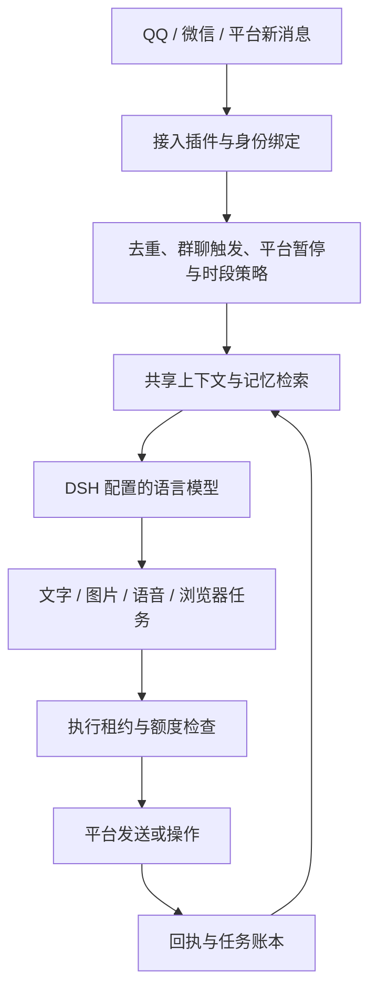

# 架构与调用链路

## 消息与记忆

`plugins/group-*`、`plugins/*inbox*`、`lib/passive-inbox.mjs` 负责入站和触发。`lib/shared-context.mjs`、`lib/memory-retrieval.mjs` 提供按身份与会话范围检索的上下文。共享记忆不意味着把私聊泄露给群聊，消息正文也不能授权更改权限。

## 语音与视频

`lib/voice.py`：生成、排队、平台发送。发送前失败和实际发送后结果未知分开记录，未知不自动重发。`lib/proactive-voice.mjs` 处理可选主动语音。

`lib/video-audio.mjs` / `lib/video-understanding.mjs`：获取实际原声、转写和分时画面，再按配置调用云模型；失败保留真实证据而不是伪造理解。`make-video.py` / `lib/video_shots.py`：素材、镜头、字幕、配音及质量检查。`creative-media.py` 是可选图生视频接入。

`lib/singing.py`：本地歌曲素材 → 人声分离 → 已配置音色的歌声转换 → 混音 → 校验 → 可选 QQ 交付。模型、曲库、音色参考均需自行准备。

## 浏览器生命周期

独立浏览器资料与用户日常浏览器分开。`lib/browser-pages.mjs` 复用所属任务页面；`lib/page-lifecycle.mjs` 回收安全的临时页和退出进程遗留页。发布草稿、输入内容及原生消息监听页保留。DSH 原生插件管理的观看页不属于本模块自动清理范围。

## 运行可靠性

`lib/fleet.mjs`：可选私有仓库中的双机租约和共享额度。公开参考仓库不能作为个人运行账本仓库。

`lib/maintenance.py`：每日清理已停写日志7天、白名单缓存3天、旧部署缓存7天。活动文件、锁、额度账本和未完成任务跳过；不处理记忆、登录、模型或素材。

`lib/setup.py`：本机插件注册、后台服务及启动入口。`lib/launchers.py` 区分个人 QQ 与机器人；`lib/qq_background.py` 仅对已识别的机器人加载器隐藏 Dock 图标。
